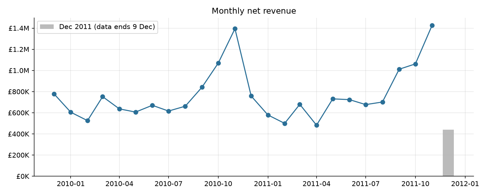
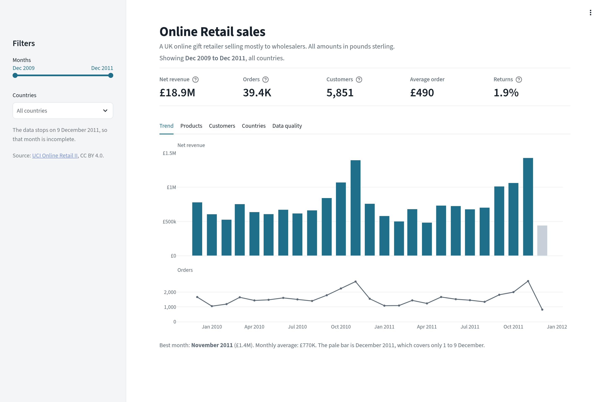

# Online Retail: sales, customer and returns analysis

Two years of transactions from a UK online gift retailer (about 1 million invoice lines),
cleaned, analysed and turned into an interactive dashboard.

**Contents:** a reproducible cleaning script, a Jupyter notebook with the full analysis,
a Streamlit dashboard, and a one-page summary of findings for a non-technical reader.



## Key findings

- **Revenue held up because existing customers spent more, while new-customer numbers halved.**
  January-November 2011 revenue was 2.3% above 2010 on 3.7% fewer orders; the average order rose
  6.2%. First-time customers fell from 3,285 to 1,511 over the same months.
- **September to November brings in about 40% of the year's revenue**, with November the peak month.
- **A quarter of customers generate 70% of revenue.** The top 10% alone account for 63%.
- **823 lapsed customers** used to order about five times each and have been inactive for around a
  year. They are the obvious win-back target before the autumn peak.
- **About one new customer in five orders again the following month.** 28% of customers ordered only once.
- **Returns are 1.9% of sales overall**, but 28-53% for a few products (cherry lights, fridge magnets).

Full write-up with recommendations: [reports/summary.md](reports/summary.md).
Analysis with all charts: [notebooks/analysis.ipynb](notebooks/analysis.ipynb).

## Cleaning

The raw file needed more than dropping nulls. Every step and the number of rows it removed is logged
in [data/processed/cleaning_log.csv](data/processed/cleaning_log.csv):

| Step | Rows removed | Why |
|---|---:|---|
| Sheet overlap | 22,523 | The two Excel sheets both contain 1-9 December 2010 |
| Exact duplicates | 11,812 | Identical lines, usually scanned twice |
| Non-product codes | 5,812 | Postage, Amazon fees, discounts, manual entries, gift vouchers |
| Zero price | 5,964 | Free samples and stock write-offs, often with notes like "damaged" |
| Cancelled within a day | 2,774 | 1,387 orders cancelled in full by the same customer within 24 hours |
| Bad-debt adjustments | 6 | Accounting entries, not sales |

The "cancelled within a day" step matters most for the results. One customer ordered 80,995 paper craft
kits (£168K) and cancelled 12 minutes later. Left in, that line ranks as the 4th best-selling product
and makes December 2011 look like a returns disaster.

Lines without a Customer ID (13.6% of revenue) are kept in revenue totals and left out of customer metrics.

## Dashboard

Filter by month range and country. Five tabs:

- **Trend**: monthly revenue and orders
- **Products**: top sellers and the products with the highest return rates
- **Customers**: RFM segments, a downloadable customer list, and repeat-purchase cohorts
- **Countries**: revenue by country
- **Data quality**: the cleaning log



## Run it

Requires Python 3.11 or newer.

```bash
python -m venv .venv
source .venv/bin/activate        # Windows: .venv\Scripts\activate
pip install -r requirements.txt
streamlit run app.py
```

The cleaned data is included, so the dashboard runs straight away. To rebuild it from the raw file,
download `online_retail_II.xlsx` from the UCI link below into `data/raw/` and run `python src/clean.py`.

## Project layout

```
app.py                     Streamlit dashboard
src/clean.py               Cleaning rules and log
src/metrics.py             Every metric used by the notebook and the dashboard
notebooks/analysis.ipynb   Full analysis with charts
reports/summary.md         Findings and recommendations
reports/figures/           Charts used in this README
data/processed/            Clean data (parquet) and cleaning log
```

## Data

Chen, D. (2012). *Online Retail II* [Dataset]. UCI Machine Learning Repository.
https://doi.org/10.24432/C5CG6D. Licensed under [CC BY 4.0](https://creativecommons.org/licenses/by/4.0/).
Prices are in pounds sterling.

Tools: Python, pandas, Plotly, Matplotlib, Streamlit, Jupyter.
